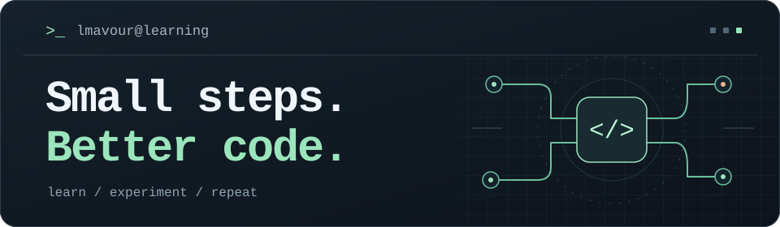

  <h1>Batara Krisna Danduru</h1>
  
<code>lmavour</code> &middot; Student developer &middot; Indonesia

  
<strong>Learning backend development. Exploring AI. Keeping things simple.</strong>

  

    <a href="https://batara.is-a.dev">Portfolio</a> &middot;
    <a href="https://www.linkedin.com/in/batara-krisna-danduru-411bba2a2/">LinkedIn</a> &middot;
    <a href="https://x.com/batara_of">X</a>
  

  

---

## About Me

I'm Batara, a student from Indonesia who started learning to code in 2023.
I enjoy figuring out how software works, trying small ideas, and learning from the process.

I'm especially interested in lightweight web tools, backend development, and AI-assisted coding.
Still learning, still experimenting, and taking it one step at a time.

## Learning Focus

- **Backend fundamentals:** Understanding how web services handle requests and data.
- **Infrastructure:** Getting comfortable with Linux servers, hosting, and DNS.
- **AI-assisted development:** Exploring AI tools while building a stronger understanding of the code.

## My Toolkit

  
  
  
  

- **Web basics:** HTML.
- **Workflow:** Git, GitHub, and VS Code.
- **AI tooling:** AgentRouter.

---

  
Credits

  
Custom terminal-style SVG banner, stored in this repository.

